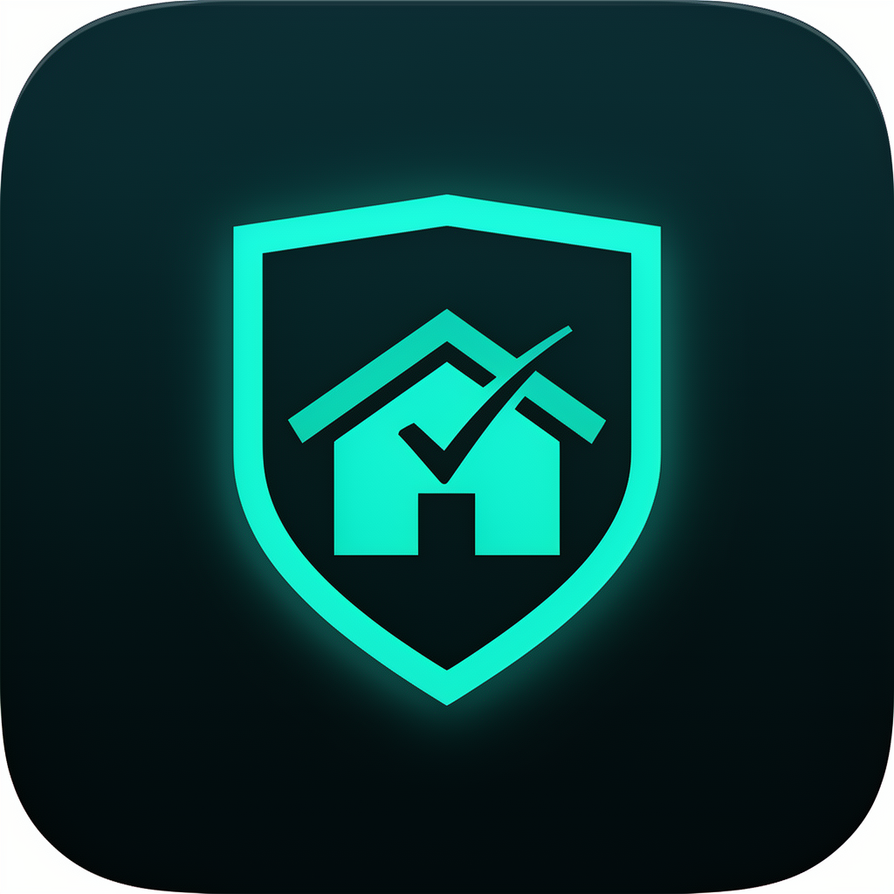

# Nakomis Home — iOS / iPadOS app



Native SwiftUI companion app for the Nakomis home infrastructure. First feature: **manual approval of pending client-certificate issuance requests** via APNs push (with Face ID gating). Built with room to grow into a general home-control app.

## Support

If you find this useful, please consider buying me a coffee:

[](https://www.paypal.com/donate?hosted_button_id=Q3BESC73EWVNN&custom=nakomis-ios)

## Architecture Diagram


## Repository Layout

| Directory | Purpose |
|-----------|---------|
| `NakomisHome/`        | App source — SwiftUI views, view models, services |
| `NakomisHome/App/`    | `@main` entry point + root `TabView` |
| `NakomisHome/Auth/`   | Sign in with Apple → Cognito federation, Keychain token store |
| `NakomisHome/Push/`   | APNs registration + interactive notification handling |
| `NakomisHome/Features/Approvals/` | Cert-approval list + detail + Face ID gate |
| `NakomisHome/API/`    | Typed `APIClient` for the home-servers API |
| `NakomisHomeTests/`   | XCTest unit tests |
| `fastlane/`           | TestFlight build + upload lane |
| `project.yml`         | [XcodeGen](https://github.com/yonaskolb/XcodeGen) spec — `*.xcodeproj` is generated on demand, not committed |

## Getting started

1. Install [XcodeGen](https://github.com/yonaskolb/XcodeGen): `brew install xcodegen`
2. Generate the Xcode project: `xcodegen generate`
3. Open `NakomisHome.xcodeproj` in Xcode
4. Build & run on a simulator or device

Push notifications, Sign in with Apple, and the API base URL are configured via the build-time `xcconfig` and the bundle's `Info.plist`.

## Backend dependencies

The app talks to the `api.home.nakomis.com` / `api.home.sandbox.nakomis.com` HTTP API defined in [home-servers](https://github.com/nakomis/home-servers) (HOME-153). It authenticates with the shared Cognito user pool (Sign in with Apple federated in) and registers its APNs device token with the backend's `/devices` endpoint.

## Architecture Diagrams

`docs/architecture/nakomis-ios.drawio` is the source for the diagram above. The SVG is auto-regenerated on commit by `.githooks/pre-commit`.

To activate the hook after cloning:

```bash
git config core.hooksPath .githooks
```

## Support

If you find this useful, please consider buying me a coffee:

[](https://www.paypal.com/donate?hosted_button_id=Q3BESC73EWVNN&custom=nakomis-ios)
